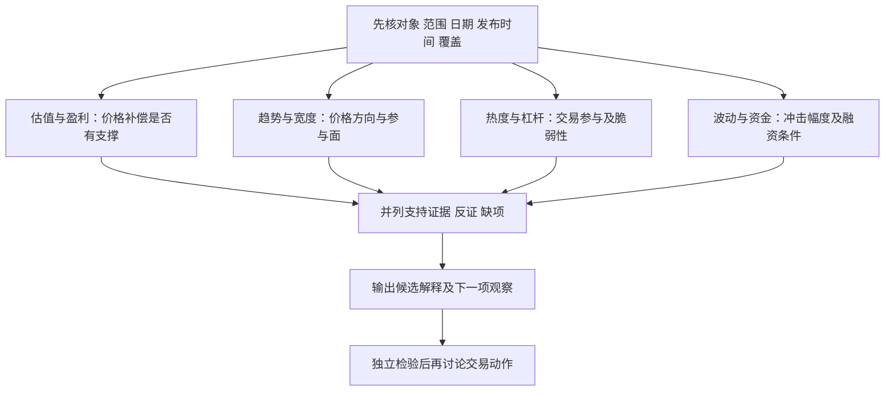

# A股与美股观察：基础补齐与组合解释审阅稿

日期：2026-11-02（北京时间）。范围：现有能力与已存资料核查、基础页面调整、指标解释方案。组合状态、仓位乘数、止损修改和新回测均未启用。

## 一句话结论（大白话）

需要补的是不同指标之间的解释关系和少数关键数据，现有宽度、股债利差、20/60日波动、VIX、信用利差及融资资料应直接复用。页面改为A股、美股同时可见的两栏；从外盘补入NFCI完整历史的近十年展示，并取得中国货币网DR007当前快照。**基础资料仍未全部补齐**：全市场同池自由流通换手率、股票口径融资买入占比、DR007连续历史与OMO历史、盈利预期修正历史仍缺。下面的结构是供用户审核的解释方案，不能把“便宜、低宽度、高波回落”直接叫黄金坑，也不能据此自动改仓位。

## 1. 先复用：系统到底有什么

| 维度 | 原有能力与资料 | 本轮实际增量 | 尚不能满足的部分 |
|---|---|---|---|
| 方向与参与面 | 既有趋势体系；全A、标普500 B20/B50/B200；宽度大图、动态参考区间 | 两市同屏小图，直接展开原大图 | 全A参与面、沪深300估值和上证波动是不同范围，不能合称同池组合检验 |
| 估值 | 沪深300股债利差三年轨道；标普500股债差原值；PE/CAPE | 复用既有来源、曲线与详情 | TTM盈利不等于盈利预期；美国盈利端月频不代表每天新增信息 |
| 实现波动 | 已有指数HV20/HV60计算与图；外盘行情无须重采 | 加20/60比值、HV20此前756观察的历史位置，两条波动曲线同看 | 历史波动不能直接解释上涨/下跌方向，也不能证明回落后更安全 |
| A股热度与杠杆 | 东财转引两融历史；融资余额、买入额、供应商融资余额占流通市值比 | 同栏展示融资余额20个有效观察日变化及余额占比 | 供应商分子可能含基金，分母的同池股票/流通定义未逐日核实；不能生成用户要求的合格股票融资买入占比 |
| 美国情绪与杠杆 | AAII、FINRA月度融资；FINRA外盘357月及既有展示包 | 核原件和现有展示一致，直接复用 | 调查不是全市场实际持仓；融资是月频，不能参与日度“同步”判断 |
| 美国资金/风险 | VIX、ICE BofA HY OAS、OFR；前端NFCI只有五周 | 外盘NFCI原件2911周、6列逐行核对；展示近十年520周 | NFCI最新版截至2026-10-16，不是今日数据；历史确有修订，不能把当前历史当首发版本 |
| A股资金 | 所查模块未发现DR007历史链 | 从中国货币网公开页面所用JSON取得2026-11-02 17:00加权利率1.3635% | 仅当前快照；未确认最终收盘，未取得连续历史/20日均值及同日OMO政策利率链，不画伪历史 |
| 盈利预期 | 目录候选；外盘AAPL单次一致预期快照 | 核清MSCI定义与供应商PIT产品，保留缺口 | 单股票单次快照不能算全市场上修广度；尚无合格美股/A股连续预期修正历史 |

原系统API实读：宽度两市到10月30日；上证/沪深300价格到11月2日、标普价格到10月29日；融资与VIX到10月30日、HY OAS到10月29日。日期不能抹平后生成“今天共同确认”。数值只用于读回验收，不在本报告形成当前交易建议。

原件清点与前端能力证据：`raw/cross-market-risk-context-2026-11-02/data-qualification.json`、API小快照、既有`market-style-observation-2026-10-20.md`及`breadth-companion-observation-discovery-2026-10-26.md`。外盘身份和原件SHA已核；原材料不移动、不覆盖。

## 2. 每个指标怎样解释阈值

先分清三类线：**定义线**只是数学或制度参照；**历史位置线**只说罕见程度；**交易线**必须有同对象、同期限、费用和反例验证。机构提供数据，不等于机构认可我们的阈值。

| 指标 | 计算和有意义的参照 | 机会侧怎样读 | 风险侧怎样读及反例 |
|---|---|---|---|
| 宽度 | 同一股票池站上20/50/200日均线的比例；复用当前B50历史P10/P90；StockCharts30/70仅原来源经验 | 低位后参与面扩散值得进一步看趋势 | 高位转弱比单纯高位更需关注；低位可持续，高位也可持续上涨 |
| 股债利差 | 盈利收益率−10年国债收益率；沪深300复用已有三年轨道及已研究版本 | 相对债券便宜是估值条件 | 盈利下修、利率变化均能改变解释；下轨不等于顶部；它不是完整资产定价意义的预期风险溢价 |
| HV20、HV60 | 简单日收益样本标准差×√252；分别21/61个有效收盘价，输出年化%；缺值窗口不算 | 同样低宽度时，可区分缓慢下跌与剧烈波动；还须看价格方向 | 低波不等于低风险，大涨也会高波；价格日线存在不等于回测已无未来信息 |
| HV20历史位置 | 当天HV20与此前756条有效HV20比较，用中秩，包含并列值的一半；不使用未来值；不足留空 | 历史位置从高位回落仅表示近期冲击减弱 | P15/P85是可讨论的观察边界，**未经收益验证**；不可跨市场统一变成仓位系数 |
| HV20/HV60 | 分母>0才计算；1表示两窗口波动相等；看连续变化 | 从>1下降说明短期波动相对中期收敛 | 旧剧烈日滚出20日窗口也会下降，不能直接认定卖压耗尽；不是期权或期货期限结构 |
| 换手率 | 股票范围、成交量/成交额、流通/自由流通股本必须先一致；取自身滚动历史位置 | 宽度改善时交易参与回升可作佐证 | 高换手也可能是健康换手或强势延续；5/60日成交量比仅是活跃度代理，不能冒称自由流通换手 |
| 融资存量及变化 | 保留融资余额/同池市值，同时单列余额20日变化率；股价下跌会抬高前一比值 | 改善期借款参与增加可与扩散同看 | 分母萎缩与融资增加不同；融资余额下降也可能是主动还款，不能直接叫强平 |
| 融资买入占比 | 同日、同范围股票融资买入额/股票成交额；基金必须两边一致处理 | 反映融资购买在交易中的份额 | 比值升高也可能因为普通成交下降；6%、10%—11%或P85均未取得本地有效阈值证据；不替代存量风险 |
| VIX、VIX/VIX3M | VIX是SPX期权约30日隐含波动；同日同口径比值1只表示两期限相等 | 高位回落表示保护需求/隐含风险价格变化 | 1.1回落到1以下不是已确认底部；隐含期限比较不等于VIX期货升贴水；纳指风险应区分VXN |
| HY OAS | 美元高收益债相对国债曲线的期权调整补偿；原值+20交易日变化，百分率差×100为基点 | 估值便宜时信用未恶化，是少一项反证 | 走阔支持融资压力解释，但不必领先股市；4.5%/5%与一年分位只作待检验候选，不能直接冻结信号 |
| DR007−OMO | 建议先算每日DR007−当日有效7天逆回购利率，再取20日均值；单位基点 | 银行间资金相对政策利率宽松是环境信息 | 税期、季末等可扰动；DR007不是全市场资金、股票入市资金或非银融资成本；不是FDR007 |
| NFCI | 0是历史平均；正值通常较紧、负值较松，方向与水平分开 | 有助补充较慢的金融条件背景 | 综合项含风险、信用、杠杆，与VIX/OAS不是独立的多票；历史会修订 |
| EPS预期修正广度 | 同一历史股票池、同预测财年、同EPS口径，对比约1/3个月快照；(上修公司数−下修公司数)/有效配对公司数；未变进分母、缺失另报 | 上修扩散支持盈利预期改善 | 负EPS不用百分比误判；FY1换年不能当上修；必须并列覆盖率、未变/缺失、等权/加权差异；MSCI Analyst Sentiment不是这条简式 |

页面目前实现了已有资料的小图、波动比值和历史位置；表中其余建议窗口与条件仍是审阅稿，没有为了好看制造缺失阈值。

## 3. 怎样串起来：四组问题，一张证据结构

建议采用**分层、可同时成立的解释标签**。当前信息不足以证明一条唯一金融因果链，也不宜让五个故事强制覆盖所有日子。

各层回答不同问题，没有加权总分，也没有谁的一票可以覆盖其他缺项：

1. **估值与盈利**：股价相对可持续盈利和债券机会成本如何；盈利数据缺失时只能写“便宜的解释尚未得到盈利验证”。
2. **趋势与宽度**：原LEI趋势负责方向，宽度说明参与是否扩散。不能把已有趋势/宽度/ERP默认说成已批准的“基础仓位公式”。
3. **热度与杠杆**：说明参与交易与债务放大的状态；它们为上涨或下跌提供脆弱性线索，不能直接识别是谁出货。
4. **波动与资金**：一个描述冲击尺度，一个描述融资约束；两者分别展示。HV仍由价格导出，与宽度不自动正交；资金环境能提供另一市场的信息，但相关压力不可重复计数。

每条解释输出固定六项：**看到什么 → 支持什么解释 → 还有什么相反解释 → 哪些数据缺/旧 → 下一项可证伪观察 → 与原交易规则的关系**。只有事实可以写“发生”；推断写“可能/待确认”。缺项单列，不当中性，也不在其他证据强时自动补成正面。

## 4. 五个候选结构，供审核

下列组合用于观察和提出检验；不填仓位百分比、不切换均线止损。出现冲突可同时显示两个标签，或显示“混合/证据不足”。进入、持续、离开按当时版本保存；不能回头重写当时解释。

| 候选解释 | 支持证据 | 必须保留的反证或替代解释 | 帮助观察什么 |
|---|---|---|---|
| 低位修复观察 | 估值相对有吸引力；宽度低位开始扩散；波动脉冲回落；信用未继续恶化 | 波动回落可能仅因旧波动滚出窗口；盈利仍恶化；反弹后再次新低 | 修复是否从少数股扩散，价格是否出现原体系认可的结构；不能叫“黄金坑已确认” |
| 低位承压 | 宽度持续低、趋势弱；估值看似便宜；信用趋紧或盈利下修 | 低波阴跌也可能是暂时冷清；缺盈利数据不能确认价值陷阱 | 便宜是否被盈利下降抵消；不把低波当安全 |
| 上涨扩散 | 原趋势转强；宽度改善；交易参与增加；资金压力未加剧 | 无盈利支持的短反弹；行业集中、权重变化仍可主导 | 价格走强是否有更多股票参与；保留原执行规则 |
| 上涨收窄且拥挤 | 价格仍强、宽度转弱；估值吸引力下降；同池换手及融资参与处高位 | 指数行业/市值结构变化；优质龙头盈利上修；趋势可能长期延续 | 用户举的高位脆弱组合；它提示复核持仓风险，不能证明“主力派发”或自动减半 |
| 下跌伴融资压力 | 价格弱、宽度下降、波动放大，并伴信用走阔或资金偏紧；若融资余额下降则记录 | 股价分母下降、主动还款、交易政策变更；没有资金链证据就不能确认被动去杠杆 | 区分普通价格回落与更广泛压力；保护性动作须沿原失效位/风险规则 |

例如用户提出的组合应表述为：**“参与面收窄、相对估值吸引力下降，同时借款交易仍活跃，市场对负面冲击可能更敏感。”** 若换手率和融资分母未核齐，结论降为“已有部分支持，拥挤程度未确认”；不能输出“筹码已派发、必然将跌”。

### 可讨论的第一版判定写法（尚未实施）

先只把“上涨收窄且拥挤”写成可复核条件，其余状态沿同样格式制定，避免一次把许多参数定死：

- 趋势强弱：直接读取原体系在该日已有的方向状态，不另发明一套均线规则。
- 参与收窄：同池B50比20交易日前低，且近5交易日均值低于此前5日均值；记录下降幅度，不把极小变化与大幅下降等同。
- 估值吸引力下降：同一版本ERP的最新可知值比20交易日前可知值低；同时报告其历史位置。周频输入按真正公布后沿用，不把变化硬说成每日新信息；吸引力下降与绝对估值偏贵分开。
- 热度处高位：同池换手率在此前756个有效交易日的位置≥P85。P85只作为待审核的初版观察边界；缺可比历史不触发。
- 杠杆仍增加：融资余额相对20个有效交易日前增长>0；融资买入占比的历史位置作为补充，不能要求月频FINRA充当日频确认。
- 五项均有同一可知时点的合格输入才可显示“条件齐备”；否则显示具体缺项。少一项不能凭其他项强自动补齐。首次满足、持续、退出分别留记录；退出表示条件不再同时成立，不等于风险解除。

这组条件回答“强势表面下是否出现参与收窄和更高借款依赖”，并不回答“何时会跌”。若原趋势未强而其他条件成立，应写“下跌/横盘中的高热度与杠杆”，不硬贴上涨背离标签。若条件极少出现或对后续压力没有增量，本方案允许删除该标签，不靠反复换窗口找到好结果。

波动标签另行并列：HV20历史位置≤P15为“相对平静”、≥P85为“相对剧烈”，其间为通常范围；比值>1/<1仅表示短期相对放大/收敛。资金条件与盈利修正保留各自水平、变化和数据日期，暂不定全球通用的硬阈值。以上均为观察阈值草案，不是已经成立的机会/风险交易线。

## 5. 对三份Gemini建议的取舍

**保留：** 先复用HV20/HV60；热度/杠杆与宽度同时看；在本轮低成本补齐的执行顺序上先展示资金条件，再补盈利预期历史；资金条件不替代盈利验证；分层解释、先状态观察再研究行动；条件比较比强行套横截面Rank IC更适合本题。

**修正：**

- “零新数据成本”可指无须买新行情，不等于零工程成本或无未来信息。需核价格调整、交易日、时点和数据修订。
- “公开日频、无事后修正、T+1一定齐”不能作为通用承诺。NFCI外盘与旧页面五周的实际修订已被本轮核出。只有原始版本、实际到达时间和范围核验才支持当时可用性。
- 融资流量占比补充存量比，不替代。不同分母问题不能靠换一个比例消失；两融包括融资与融券，不能当融资余额。
- DR007与HY OAS分别测银行间资金价格和企业信用补偿，不能当中美完全等价的“缺钱开关”。
- 市场底部估值“必然极好”、趋势“必然极差”均过强。低波不必满仓，高波回落不是抛盘衰竭的直接证据。窗口滚动效应、成长与盈利变化均为反例。
- NAAIM是成员自报股票敞口均值，不能代表全体机构或剩余卖压；官网当前说明公开页面延迟三个月，及时数据及长历史另有订阅。不会按第三份材料自动接定时任务或付费。
- RSP/SPY可观察等权相对市值加权表现，但也反映行业、规模、再平衡及费用；需统一含分红回报，不能由下降直接证明“完全靠科技巨头”。不能把TV通用宽度代码未经对象核对就当标普/纳指宽度。
- 所谓美联储“净流动性”是选定资产负债表项目的组合代理，不是可买股票的钱，也不是官方准备金恒等式；不同单位、日周频和发布日期必须统一。暂不加到首批，避免扩大本题。
- 自由流通股本与普通流通股本不能混用；`turnover_rate_f`、`circ_mv`等字段需逐个核官方数据字典，不能凭名字把两者当同一口径。财报实际改善可作为另一类经营信息，不能冒称分析师预期替代品；`ann_date`单字段也不能独自排除修订回填。
- P85、融资占比6%/10%—11%、行业成交40%—45%、OAS4.5%—5%、VIX比值1.1都不因被列为“机构常用”就具备本地有效性；不统一写入风险阈值。

MSCI官方方法尤其需要区分：Analyst Sentiment涉及销售、EPS、现金流、目标价、推荐等多组描述；EPS修订比用上修预测数减下修预测数，除以同窗EPS预测总数，再按最近三段约21交易日以3/2/1加权；不是公司家数广度。我们可另定义公司修正广度，但不能标为“MSCI官方指标”。官方论文能读、API能连、历史数据可取得、使用许可及策略有效性是不同事实。

## 6. 怎样评价组合有没有帮助（待审核后另定合同）

先选一个用途：**在已知估值、趋势与宽度之后，新增信息能否更早区分随后压力较大与较小的情形**。首轮不同时优化入场、退出和仓位。

- 主对象分别固定A股/美股宽基及对应股票池；A股全A辅助广度不得充当沪深300同池广度；同池/跨市场背景分开。
- 比较原信息、单新增维度、联合维度；所有比较用共同合格日期，并报告被缺失排除的日期。慢变量只在真实公布后沿用，保留“年龄”，不能按报告所属月倒填。
- 20/60交易日可以作为待定的观察期限；固定一次，不能看到结果后挑窗口。区分“从观察时点到随后最低点的损失”与“随后路径内最大峰谷跌幅”，两者不可混称最大回撤。
- 主要报风险事件率、损失分布、覆盖率、提前量、漏报/误报及分时期差异；连续多天同一状态要合并看事件，重叠未来窗口不能当独立样本。短窗口条件收益不要硬算年化Sharpe/Calmar。
- 若以后研究仓位，必须比较原规则、固定较低仓位、简单波动控制，再计完整账户、现金、成本、少亏和少赚、错失大涨。季度前向观察可验数据与可解释性，不能替代跨周期效力证据。

已有账户证据不重跑：2018-07-05—2026-06-30、每次买卖0.1%、初始100万元。下表来自本地已封存报告，本轮仅核表中差额，不是新增独立市场验证。

| ETF | 原宽度：年化收益/最大下跌 | 宽度+波动：年化收益/最大下跌 | 对原宽度的增量及代价 |
|---|---|---|---|
| 510300 | 7.69% / 26.89% | 5.86% / 21.38% | 最大下跌少5.51个百分点；期末少23.07万元 |
| 159915 | 18.77% / 32.40% | 8.35% / 22.32% | 最大下跌少10.08个百分点（四舍五入原表记10.09）；期末少205.20万元 |

相对固定半仓，组合期末资产分别多25.89万元、1.23万元；单边费率到0.2%时，创业板组合187.55万元低于半仓188.14万元。风险投入并不相同，不能说同风险多赚。只有两只相关ETF、反复看过的历史，历史成员与到达时间仍有缺口；这些证据足以反对“波动高自动降仓必然更好”的笼统断言，不能否定所有波动用途。原报告：[宽度与波动率仓位比较](breadth-volatility-increment-2026-10-20.md)。

## 7. 来源与实际获取边界

1. [MSCI Analyst Sentiment方法，2025-04](https://www.msci.com/documents/10199/a925c038-cf5e-9701-fe7a-e4414a06b1ca)、[官方研究，2025-09](https://www.msci.com/downloads/web/msci-com/research-and-insights/paper/analyst-sentiment-from-factor-to-indexation/Analyst%20Sentiment.pdf)：本轮阅读方法，不是取得序列。
2. [LSEG Quant Research数据册](https://www.lseg.com/content/dam/data-analytics/en_us/documents/brochures/data-for-quant-research.pdf)、[I/B/E/S Global Aggregates](https://www.lseg.com/en/data-catalogue/company-data/ibes-estimates/global-aggregates)：PIT/历史/当前产品不同；未开通付费数据。
3. [Cboe VIX说明](https://www.cboe.com/tradable-products/vix)、[VIX期权规格](https://www.cboe.com/tradable_products/vix/vix_options/specifications)：约30日SPX隐含波动；本地当前VIX数据链仍按原系统来源标识，不能因定义官方就冒称抓取也来自官方。
4. [FRED/ICE BofA HY OAS](https://fred.stlouisfed.org/series/BAMLH0A0HYM2)：2026年4月起公开窗口近三年，包含许可说明；NFCI长史不能替代OAS长史。
5. [Chicago Fed NFCI](https://www.chicagofed.org/research/data/nfci/current-data)：本轮使用已有外盘当前版本；首发历史须另用已存ALFRED版本核准。
6. [中国货币网行情](https://www.chinamoney.com.cn/chinese/mkdatapm/?tab=2)、[当前公开数据](https://www.chinamoney.com.cn/r/cms/www/chinamoney/data/currency/prr-md.json)、[FDR定盘说明](https://www.chinamoney.com.cn/chinese/bkfrr/)：DR007与FDR007不同；公开首页快照不等于可自动取得完整历史。
7. [上交所股票成交概况](https://www.sse.com.cn/market/stockdata/overview/day/index_his.shtml)：官方区分总市值换手与流通市值换手，口径有调整；本轮不拿短21日快照做三年换手分位。
8. [NAAIM当前说明](https://naaim.org/programs/naaim-exposure-index/)、[FAQ](https://naaim.org/programs/naaim-exposure-index/faqs/)：自报样本、公开延迟及访问条件，以本轮看到的官网为准。

## 8. ARCHIVE与接续边界

本轮基础资料审查和有限前端增量可完成；全部数据补齐尚未完成，组合解释是`plan_only / awaiting_user_review`，金融效力为`not_evaluated`。原六次网页核查和新增基础获取四次全部留账；中国货币网两条直接页面在网页工具失败，随后沿可访问公开首页到原JSON取得一个快照，未绕过登录/付费。没有行情全量重采、金融回测、交易动作、定时任务或后台续跑。

定义/实现：HV复用既有公式，新增比值/分位已核边界及真实价格；新行情完整性、交易时点和所有组合收益不在本次验收中。两市小图、展开详情、来源/日期、未知状态和桌面展示由主控读回。具体代码与验证指纹见同名raw的`acceptance.json`；新公共展示包只含公共金融资料，不含外盘私人路径。

恢复资料补齐时先读本报告、`data-qualification.json`、尝试账、源版本和协调记录，不重下FINRA/NFCI、不把AAPL单点当历史、不覆写旧研究。后续方案若用户认可，先选一个风险用途和对应同池日期，再冻结效力研究；原技术交易规则继续保持。
