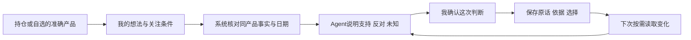
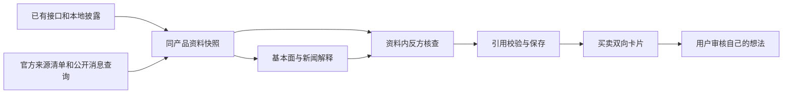

# 日常投资判断与 Agent：可借鉴的产品和架构实践

核查日期：2026-10-14；跨日整合于 2026-10-15。范围：公开原项目、官方文档和原作者方法文章；没有安装产品、接入账户或做收益实验。

## 一句话结论（大白话）

建议优先做好三件事：**一句话提出买卖想法，带着依据和反对理由审核；保存你当时确认的判断；以后打开时直接看到哪些事实变了。** 本次查到的优秀实践支持这种做法。已有理财软件更擅长账目和组合，Agent 框架更擅长流程与恢复；我们需要把它们各自有用的部分接到现有系统中。查到这些做法，不代表已经证明它们能提高投资收益。

2026-10-15补注：机会报告已采用“已有接口取资料 → Pro解释基本面与新闻 → Pro核对反对理由 → 引用检查与保存 → 买卖双向卡片”。真实整批已经执行，失败与资料缺口逐项保留；具体数量和限制见本轮补注及验收回执。

## 问题、已有基础和证据范围

用户的核心痛点是：系统积累了行情、因子和基本面，但这些信息还没有稳定地帮助回答“我现在为什么想买/卖、依据够不够、后来有没有变化”。比较基准是现有今日候选、持仓行业参考、Agent 问答与冻结材料、完整交易计划。此次调研只选择能补上这条使用流程的思路。

共整理 19 条原始来源记录，涉及四个理财/投资日志项目、判断日志方法、两篇 Agent 工程原文、两页持久化文档和一个多 Agent 金融项目。产品执行者记录 29 次来源操作、1 次访问失败；Agent 执行者记录 10 次搜索、6 次直接打开、14 次页内定位。主负责人另直接打开 7 个关键原件，核对方法、产品和恢复限制。检索计数是实际工作量，不能当作质量评分或完整覆盖率。

X/Twitter 检索未找到本轮可核读的相关原作者原帖，未采用转述内容补齐。GitHub README 和官方文档只能证明项目公开描述的能力；本轮未安装运行，不能声称已实测它们的体验、计算或安全性。原件与读取范围分别保存于 [产品来源](raw/decision-mainline-practices-2026-10-14/product-sources.json) 和 [Agent 来源](raw/decision-mainline-practices-2026-10-14/agent-sources.json)。

## 值得关注的整合清单

“优先”表示建议纳入已获授权的主线；“以后”需先出现实际使用需求。以下适配方法和优先级是对 LeiSignal 的判断，原作者没有为本系统做验证。

| 优先级 | 来源与实际做法 | 我们值得借鉴的部分 | 使用成本、限制与验收方式 |
|---|---|---|---|
| 优先 1 | [Farnam Street 判断日志](https://fs.blog/decision-journal/)：决策前记录情境、考虑、理由和预期，事后再核对 | 保存你的原话、资料日期和“什么变化会让我重新考虑”；后续复核追加，原文保留 | 完整长表会增加负担，先只要求产品、方向和理由。验收：隔日能看到原话及原依据，后来的结果不会改写当时记录。没有合理依据时不填精确概率 |
| 优先 1 | [Actual 对账流程](https://actualbudget.org/docs/accounts/reconciliation/)：明确待核对、核对完成和锁定状态 | 明确区分审核中、审核完成、你已确认、后来复核；确认卡展示即将保存的准确内容 | 账目吻合容易验证，投资判断成立更复杂。确认只证明你认可这份记录；不能显示成“买入有效”。验收：没确认不会进入正式判断；重试不会多一条 |
| 优先 1 | [Portfolio Performance 资料质量](https://help.portfolio-performance.info/en/concepts/portfolio-performance-terminology/)：显示首末价格日期、缺失、来源与事件 | 每条依据绑定准确产品、资料日、来源和用途；对旧资料与当前未知给直接说明 | 数据完整不等于分析正确。验收：基金披露、行业 ETF、基金净值分别显示对象和日期，不把行业价格当基金退出价 |
| 优先 1 | [Anthropic Agent 工程](https://www.anthropic.com/engineering/building-effective-agents)：从简单流程开始，根据实际结果检查进度 | 用明确的四步流程串起已有查询和问答；只在需要找反证时增加额外查询 | 自主循环会增加等待、费用和误差；文章也说明部分工具信息已更新。验收：同一问题从提出到保存可走通，失败有记录且可恢复 |
| 优先 1 | [LangGraph 人工确认与恢复](https://docs.langchain.com/oss/python/langgraph/interrupts)：暂停后按原标识恢复，提醒节点重跑可能重复副作用 | 借鉴稳定请求编号、保存完整待确认内容、重试防重和写后读回，复用现有 SQLite 即可 | 恢复到错误对象、刷新后重复写入是实际风险；框架状态不等于用户授权。验收：确认已成功但响应丢失，刷新后仍能核对到唯一记录。此处没有推荐安装 LangGraph |
| 下一项 | [Ghostfolio](https://github.com/ghostfolio/ghostfolio/blob/main/README.md)：组合概览、静态风险、简洁模式和逐层下钻 | 首页只放“需我处理的变化”和“我的判断”；金额、长材料、研究细节按需展开 | 它主要解决组合查看，不能替代判断审核。验收：用户能从今日页直接进入准确基金/ETF 的判断，少跳转、少重复填资料 |
| 以后 | [TradeNote 日志与长期方法](https://tradenote.co/diary-playbook.html)：单次想法/情绪与长期方法分开；[备注与附件](https://tradenote.co/complementing-trades.html)关联交易 | 单次判断可加很短的备注，长期规则复用原策略；将来已确认成交关联原判断，复盘是否遵守了当时条件 | 它偏交易复盘；满意度和盈亏不能单独评价判断质量。验收：一次执行能追溯原判断、后续改变与实际行动，账本不重复记金额 |
| 有条件再做 | [Anthropic 上下文工程](https://www.anthropic.com/engineering/effective-context-engineering-for-ai-agents)：保存轻量引用，按需读取原件 | Agent 先取相关产品、原判断和新变化；需要说明时再展开消息、披露和研究，避免每次塞入全部材料 | 过度摘要会丢反例，重查会遇到来源失效。验收：回答能定位到实际原件和日期，失效链接保留缺口，不把摘要当新证据 |
| 暂缓整套引入 | [TradingAgents](https://github.com/TauricResearch/TradingAgents)：多个角色分析并讨论支持/反对观点 | 先借鉴“明确找反对依据”，用现有一次审核实现；只有证据冲突复杂时再考虑独立反证审核 | 多个角色可能共用错误资料，意见一致不等于可靠。原仓自述能力和历史结果不能外推到本系统；若增加调用，须确实找到会改变判断的新反例 |

## 建议的产品主线

首页围绕三个动作组织：**看今天值得核对的对象；审核我的买卖想法；复核已保存判断的变化。** 自选和持仓都是这条主线的入口，详细研究继续保留原入口。

建议审核卡先回答：现在能得出什么结论、支持依据、反对依据、下一步关注什么。日期与来源可展开。没有原交易计划时可以记录今天的新想法；原来为什么入场仍留空。用户的文字关注条件先由审核解释，不能假装已全部转换为自动监测规则。

“发现机会”继续使用已有规则和准确产品资料。已有持仓可分析卖出条件；自选可核对买入条件。基金实际行业范围依据有日期的披露，行业 ETF 提供方向参考；基本面解释背景；因子显示自身证据适用范围。技术判定仍由现有 Python 规则层负责，不把多种意见投票成一个新信号。

## 建议的实现边界

| 组成 | 复用什么 | 必须保留的约束 |
|---|---|---|
| 事实读取 | 持仓、自选、同产品技术资料、公开披露、原研究记录 | 产品身份、资料日、取得时间和用途；资料缺失如实保留 |
| 审核 | 现有 Agent 问答和提问时的材料快照 | 问题、回答、产品、材料一一对应；支持/反对内容可追溯 |
| 判断记录 | 新增薄的判断与确认关联；复用原问答存证 | 原话不覆盖，复核追加；确认与重试用稳定编号；计划与成交仍走原账本 |
| 变化展示 | 按需读取已取得的事实，与原日期比较 | 新资料尚未取得时写未知；盘中或过期资料不能宣称已触发当前交易条件 |
| 评价 | 单个实际问题的前后记录 | 看是否找出具体遗漏、改变了哪项判断、等待是否可接受、有没有串对象或重复记录；收益效果另有证据要求 |

本轮已获授权的主线实现与本调研同步推进；实现是否通过以本任务 `decision-mainline-acceptance.json` 及实际页面为准，本报告只验收调研结论。更完整的行情变化、成交关联和效果统计属于后续缺口，先按真实使用需要补。没有恢复主动通知；如果以后另行启用提醒，应只发送已确认关注事项的有意义变化，并让用户能打开原判断。

## 维护与采用成本

| 项目 | 核读到的维护与许可信息 | 对当前采用的意义 |
|---|---|---|
| [Ghostfolio](https://github.com/ghostfolio/ghostfolio/releases) | 发布页列 3.80.2，2026-10-06；README 标 AGPLv3 | 参考组合展示与权限设计；不复制整套服务 |
| [Actual Budget](https://github.com/actualbudget/actual/releases) | 发布页列 v26.9.0，2026-09-01；仓库标 MIT | 参考明确状态与导入去重；暂不增加预算模块 |
| [Portfolio Performance](https://github.com/portfolio-performance/portfolio/releases) | 发布页列 0.89.0，2026-10-11；代码 EPL-1.0，手册另有许可 | 参考资料质量与账户/证券交易分层；未验证其新实验接口 |
| [TradeNote](https://api.github.com/repos/Eleven-Trading/TradeNote) | 公开 API 的最近代码推送为 2025-04-14，未归档；GPL-3.0 | 可以借鉴字段和流程，现成移植需重新评估维护 |
| LangGraph / TradingAgents | 在线文档和 README，未锁定实现版本、未安装；TradingAgents 仓库标 Apache-2.0 | 本轮只采用设计思想。若以后引代码，须另核准确版本、许可和本地运行结果 |

以上维护快照来自来源清单的官方发布/仓库链接；仓库元数据更新日不能代替代码推送日。没有逐项法律审查或国内基金数据适配验证，因此不以“开源”推断可直接复制、免费运营或已经适用。

## 反例与不确定性

- 只显示组合收益，用户仍不知道某次判断为什么做出；只保存聊天，也难以比较原依据和后来变化。
- 多加一个模型可能只是重复已有资料；先用能否找到具体遗漏评价增量，不能用角色数量评价可靠性。
- 一次判断赚钱，可能只是市场整体上涨；一次判断亏钱，也可能按原条件合理执行。需要分别看推理依据、执行和结果。
- 资料更新晚、持仓覆盖不全、外部来源失效都可能让复核停留在未知。这个状态必须在界面可见。
- 本轮没有用户可用性对照、模型准确率实验或收益验证。界面与流程建议仍需用户试用，不能将文献建议写成已证明的日常收益增量。

## 2026-10-15 机会报告流程补注

本次新增问题是：机会报告由谁取资料、怎样分工，以及能否用真实模型从资料读到页面。比较基准是上轮已经接入但四次模型环节超时、未取得综合答复的版本。本次保留原失败，不重做资金或因子实验。

### 实际职责与数据流

| 环节 | 读取什么、从哪里读 | 交付与边界 |
|---|---|---|
| 系统资料读取 | 既有持仓/自选接口确定准确产品；已有分析服务取得同产品行情、阶段、技术条件；本地基金披露和行业参照；已核官方公开资料清单 | 每条资料带对象、日期、来源和用途。基金行业ETF只解释相关行业，不能代替基金买卖价格。私人备注、账户金额、计划原文不进入自动公开资料模型请求 |
| 公开消息补充 | 近七日同产品名称/代码普通查询，以及风险方向查询；Google News RSS返回标题和链接 | 两个方向共用查询结果，保留实际查询/时间/命中数/错误。标题是待核线索，没有自动读完文章正文；搜不到不代表没有风险 |
| 基本面与新闻 Agent | 读取上述公开资料快照，包括基金披露、经理观点、行业参照和消息线索 | 解释行业构成、已有经营/估值事实和资料局限；有准确来源才能引用数字。两方向共享同产品背景，不修改技术信号 |
| 资料内反方 Agent | 读取原技术卡、同一批公开原件及第一位Agent的分析 | 检查事实混淆、过期、引用遗漏和推断漏洞；从不同角度检查同一批材料，不能冒称独立找到了新原件。买卖技术状态继续由Python规则层决定 |
| 程序校验与保存 | 核对产品、引用编号、证据类别、输出完整性；不变资料复用、失败留档 | 正反材料的机械分类由程序确定；模型解释附原件编号，资料未变不重复调用。来源编号正确仍不等于推理一定正确，真实输出需语义验收 |
| 用户页面 | 同一产品同时展示买入、卖出、主要依据、技术反对点、反方检查和背景 | 先扫读结论，再展开完整来源及失败说明；缺同产品条件直接说明。审核想法进入原判断流程，保存仍需用户确认 |

### 这次从原项目借鉴什么

新增原件核查固定了 [TradingAgents源码版本](https://github.com/TauricResearch/TradingAgents/blob/1394a3f72aa4393e1a98f51b382434c4b4c2d972/tradingagents/graph/setup.py)。它将不同分析职责汇合，再交研究和风险环节；我们采用明确职责和汇合点。它的新闻与情绪角色都可能取同一产品新闻，这提醒我们先去除重复来源，不能把多个角色引用同一新闻当成多份证据。本系统不移植其自动交易决策链，也未运行其投资效果。

[OpenBB官方资料接口设计](https://docs.openbb.co/odp/python/developer/extension_types/provider)将参数检查、数据取得、输出转换分开；我们采用明确产品身份、日期、数据单位与缺失状态的做法。统一字段只能减少格式错误，不能证明资料及时或适合当前判断。新增原件、读取范围和反例见[本轮来源清单](raw/decision-mainline-practices-2026-10-14/report-pipeline-20261015/architecture-sources.json)。本次未安装外部平台。

### 实跑结果与实际改进

保留用户选定的 DeepSeek Pro，两位分析角色共用同产品资料；最多两个产品并行，每次只处理一个产品的买卖方向。基本面成功时反方失败，可直接复用基本面，失败原因分环节保存。

本轮完整读取34个产品，形成68张买卖方向卡。与上轮无法取得真实综合答复相比，本轮已取得并保存真实的基本面说明与反方检查，能够在页面上看到对应原件。易方达信息产业混合A的中报经理观点已进入模型：报告期增加AI算力/半导体、减少软件/消费电子配置；页面把这条行业说明放在紧凑卡片前面，并显示报告期和发布日期。它只解释当时的配置，不宣称当前持仓仍然相同。SOXX用官方行业比例解释产品范围，消息标题仍标待核。

修复与失败均保留：

- 原请求超时、输出截断；兼容请求返回后又出现格式围栏、证据类别混用、数字没有对应引用、内部编号泄漏等问题。程序负责原技术材料的分类，模型只解释与核反例；完整JSON围栏可解析，引用错误仍拒绝采用。
- 普通消息和风险方向消息去重，同名代币不混入ETF；查询时间、命中数量、错误和链接可查。新闻标题不能升级成已读正文或已证实事实。
- SQLite写入争用曾导致已退出进程留下4张“审核中”。修复后在有限时间内重试写入，过程中不重新请求模型；异常清理只处理本次领取的卡，确认没有其他活跃执行者后才能恢复遗留卡。原未成功存库的模型回包无法追溯，这一失败保留。
- 独立语义核读发现SOXX反方曾把新闻当用户提出的理由、把筹码代理估计说成确定支撑。增加明确限制及检查，只对这两张卡重新核对，原答复留档。
- 页面按产品合并买卖两侧，分别展示反对理由；共同背景共享、相同来源合并显示；完整原件与失败原因可以展开。已验375像素窄屏无横向溢出。

最终逐项数量、真实调用回执、版本指纹及未通过项以[本轮验收](../archive/handoffs-plans/investor-workspace-simplification-20261012/opportunity-workflow-acceptance-20261015.json)为准。请求返回、格式通过、引用核对和投资判断正确分别检查，不能互相代替。

### 仍需补齐的能力及优先顺序

1. **同产品技术资料。** 当前只有5/34个产品取得同产品技术材料；基金已有披露和行业ETF背景仍不足以生成其自身买卖时点。下一步优先解决准确基金身份与可用于原规则的同产品资料，不能直接拿行业ETF触发基金买卖。
2. **原文与资料更新。** 新闻目前读取RSS标题和链接，未自动核读正文；部分基金披露正文和完整行业标签缺失。先补直接影响当前持仓判断的原件及日期，再扩大覆盖。
3. **模型解释稳定性。** 同产品引用和数字核对已加强，但语义检查不能穷尽推理错误。失败不自动反复调用，页面保留原材料；新错误按具体类型修复和有界复核。

已核两只海外ETF官网2026-10-13截面并更新来源清单；旧清单保留在本轮raw目录。SOXX行业/市盈率和XLK行业/预期市盈率口径分开，不能混比；未补造历史估值或盈利趋势。页面打开读取已核来源清单，尚不会自动重读这些官网正文。基金仍依赖已保存披露，最新持仓与完整行业覆盖不作保证。首个14:30定时触发没有在本轮验证；本轮没有改定时器。

## ARCHIVE

本轮有界问题已回答：适合借鉴的产品做法、架构思想、优先级、成本与反例已列明。证据状态：公开原件核读；结果性质：工程与产品建议；结论 `mixed`（可支持设计取舍，使用和收益效果待验证）。不新增资金实验，不使用或重置原月度/固定投入次数。

主负责人独核原件：Farnam Street 判断日志正文；Actual 对账 Work Flow；Anthropic 简单流程/实际结果段；LangGraph 暂停恢复/重复副作用；Ghostfolio 定位与 Features；TradeNote Diary/Playbook；Portfolio Performance 资料质量字段。原作者网页未明确列出的出版日期保留未知。失败：TradeNote commits 网页 robots 限制，执行者改读公开仓库 API；X 未取得可用原帖，未重复访问绕过。

冻结范围见 [brief](raw/decision-mainline-practices-2026-10-14/brief.json)。两位 Sol/medium 执行者分别维护原来源清单，主负责人完成交叉核读与整合。实际费用未知。当前阶段没有待跑的研究；实施验证单独记录，后续只在真实缺口出现时继续。
