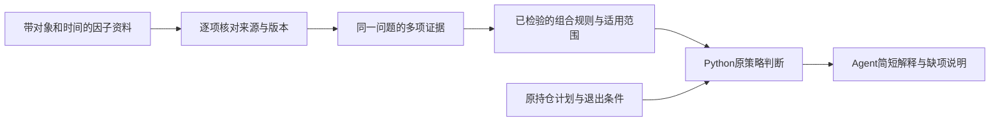

# 因子研究纠偏与多因子决策接入

2026-10-15；任务 `research-utility-review-20261012`。本轮复用已封存研究，修复实际发现的研究呈现与因子读取问题；没有重新训练、扫描参数或重跑市场回测。

## 一句话结论（大白话）

**已修正机会统计容易误读、报告弱化简单基准、一个产品只读取第一项因子这三处问题；科创50的两项历史因子已能一起查，但还没有证据证明它们组合后能改善买卖。** 以后研究先说明要帮助哪一个判断，再回答相对简单办法改善了多少、放弃了多少机会、还缺哪些条件；只研究价格信息的报告仍可独立结案，不强行编造买卖结论。

## 1. 哪些判断成立，哪些需要纠正

| 问题 | 核查后的结论 | 本次处理 |
|---|---|---|
| 买入条件太苛刻，所以没有结果？ | 不能这样直接推断。条件会缩小可观察机会，但数量少还可能来自历史太短、所需小时资料缺失、多个观察共享同一段行情。把规则放宽到好看并不能证明有效。 | 保留全部观察起点、成熟可算数量和排除原因；不擅自放宽策略。 |
| 新因子只比一个较弱模型好一点？ | 已有价格候选确有这个问题。原工具已经计算简单基准，但通用报告首屏没有充分突出它。 | 通用报告前置原基准、已有信息和新增因子后的同指标结果，以及相对简单基准的差额。更强的专项简单对照仍需按其原材料单列，不能换名混用。 |
| 研究没有回答买卖？ | 多数被检验的是未来价格或风险信息，尚未检验完整操作。预测少错不等于账户多赚。 | 从原合同读取“原问题、实际测量、用途、已测/未测范围、观察和行动时点”，写明本报告没有评价的操作。 |
| 没有多因子接入？ | 目录已有多项绑定能力，产品问答却只取第一项；这是实际代码缺口。 | 改为逐项读取，保留对象、版本、日期、单位、材料及失败原因。组合研究未做就明确显示未评价。 |
| 需要不断增加模型或Agent？ | 角色增加不提供新市场事实；重复使用同一价格资料也不成为独立证据。 | 共用核验后的资料，各组件职责分开；没有新增模型调用或自动权重搜索。 |

**纠正此前对137次等待机会的说明：原报告已经统计全部去向。** 88次在SMA确认前EMA不再向上，47次确认且共同终点完整，2次确认但终点未成熟。88次中有34次最终仍上涨，按事件直接平均的首尾变化为−0.4316%。这些是参考价格路径，不能叫34笔真实漏买交易，也不能给未发生的等待交易补零收益。真正未回答的是完整资金安排下，等待、费用、空闲资金及后续机会共同造成的结果。[原报告及反例](/library?report=docs%2Fexperiments%2Fema-sma-waiting-path-2026-10-02.md)

## 2. 现有表现与增量：不把接入成功算成有效因子

以下沿用原来8只ETF、2023年至2026上半年6072条记录、759个评价日期；包括4只宽基与4只行业ETF，不包括创业板159915。数值是把预测偏差平方后取平均，单位是“百分点的平方”，越小越好，**不是收益率或胜率**。

| 方法 | 预测平均平方误差 | 相对已有价格信息少错 | 相对逐只ETF历史平均多错 |
|---|---:|---:|---:|
| 所有ETF共同历史平均（原报告B0） | 15.0846 | — | 1.0269 |
| 逐只ETF较早已成熟历史平均（另一个更强简单对照） | 14.0578 | — | 0 |
| 已有价格信息（B1） | 15.4987 | — | 1.4410 |
| 已有信息＋20日平均日内波动 | 15.4249 | 0.0738 | 1.3671 |
| 已有信息＋60日平均日内波动 | 15.4181 | 0.0806 | 1.3604 |
| 同时加入20日和60日 | 未评价 | 未评价 | 未评价 |

20日的少错范围为−0.0367至+0.1724，允许改善也允许恶化。60日单项为+0.0161至+0.1432；这不能消除同时尝试多个候选后的挑选问题，也没有超过更强简单对照。两个单项不合格，不能直接推导所有组合都无效；同时能读到两个数，也不能推导组合有效。本轮不根据已见结果挑权重再宣称验证成功。

来源：[20日研究和更强简单对照](/library?report=docs%2Fexperiments%2Fprice-volume-range-mean20-eight-etf-2026-10-04.md)、[60日研究](/library?report=docs%2Fexperiments%2Fprice-volume-range_mean60-eight-etf-2026-10-04.md)、原 `range-mean20-fixed-prediction-diagnostics.json`。14.0578不是原报告B0；保留两种简单比较的准确身份。未把平方误差改善开方冒充另一种误差的改善。

| 本次修正 | 可核对的增量 | 没有证明的效果 |
|---|---|---|
| 机会统计 | 增加全部起点、可算数量、缺失/未成熟/跨阶段原因；原可算结果不变 | 没有增加独立行情次数或提高胜率 |
| 报告首屏 | 直接看见研究用途、基准与未评价项；用旧60日结果完成展示演练 | 没有改善原模型预测或交易收益 |
| 多因子问答 | 588000从一项变为两项可追溯历史观察 | 没有实时资格、组合绩效或买卖授权 |

## 3. 实际接入与可读性

真实例子为华夏上证科创板50成份ETF（588000）：2026-06-30的20日平均日内波动4.5858%，60日为3.8938%。这里的波动是每日最高价与最低价之差相对前一日收盘价的比例，再取指定窗口平均，**不是预期收益**。60日值按既有正式定义和原经济价格资料计算，独立算术核对差为0；没有拟合模型或计算新的策略表现。

首屏只给短结论、两项带日期的读数；完整版本、研究范围、失败原因和原件放到展开内容。两项同源且窗口重叠，不能当作两份独立确认。

| 请求或异常 | 接入要求 |
|---|---|
| 查询588000的2026-06-30历史因子 | 两项并列，明确组合效果尚未评价，尚不能据此判断买入或卖出 |
| 查询“现在” | 不借用历史值作当前值；各项当前读数和日期留空 |
| 查询没有保存的日期 | 每项分别说明缺资料，不能凑出共同日期 |
| 各项日期不同、同项版本冲突、来源变动 | 保留逐项状态，不生成组合权重、综合评分或买卖结论 |
| 159915 | 保持原单项历史动量资料；不挪用本次8ETF研究绩效 |
| 易方达全球成长精选混合(QDII)A（012920） | 仍明确未绑定适用因子证据，不以另一只ETF代替 |

实际8000接口已核588000双项、当前未知、159915单项及012920无绑定；5188网页已核简短首屏、展开两项来源，以及刷新后通过历史对话重新打开，两个读数和买卖边界保持。用户主观使用效果仍待验收。

## 4. 从权威项目借鉴的架构

我们沿现有系统补齐下列关系，没有安装外部平台：

其中“已检验的组合规则”目前是明确缺口，不能因为前后环节能连上就假设它已经存在。

- **多个信号进入系统，需要另有明确组合规则。** QuantConnect把信号模型与组合处理分开；其基础组合实现常只取同产品最新有效信号，文档也提醒多模型场景需自己明确处理。我们借鉴身份保留和职责分离，不照搬其默认取最新值的办法。[信号模型](https://www.quantconnect.com/docs/v2/writing-algorithms/algorithm-framework/alpha/key-concepts)、[组合处理](https://www.quantconnect.com/docs/v2/writing-algorithms/algorithm-framework/portfolio-construction/key-concepts)
- **预测、买卖决定、费用后评价分别核。** Qlib将模型分数、策略生成交易决定、模拟执行及费用分析分开。我们采用这一边界：只有预测证据的因子，不直接变成“可以买”；实际决定仍遵守本项目Python技术规则。[Qlib策略文档](https://qlib.readthedocs.io/en/stable/component/strategy.html)
- **行情发生日期与当时能否取得资料是两件事。** Feast的时间匹配文档区分事件时间和记录创建时间，当前文档提供可选创建时间过滤；默认按事件日期对齐并不足以排除后来补录。我们现有包历史到达时间未知，继续明确标注事后重建，不能因观察日期正确就声称历史实时可用。[Feast时间匹配](https://docs.feast.dev/getting-started/concepts/point-in-time-joins)

本轮共5次网页工具请求；定向X搜索未取得可核验且相关的原帖，不列作证据。Carver博客读取失败及猜测文档链接404保留在来源记录，未用搜索摘要代替原文；外部AI本轮新增请求0，先前审查仍仅是参考。

## 5. 之后按什么单位交付研究

沿用现有问题合同、实验账本和报告模板，不另建一套控制平台。每次尽量完成一个有边界的判断问题：

1. **先定义动作问题与基准。** 例如“已出现原日线机会时，等原均线确认是否值得”，明确何时观察、何时允许行动、适用产品、原退出条件、相同资金与费用。至少保留与问题相适应的简单办法；不在看到结果后改选较弱基准。没有完整执行定义时，明确降为信息问题，不借名完整策略。
2. **先保留全部机会，再分去向。** 最初观察、满足条件、后来失效、缺资料和未结束分别数；连续日期和相似ETF共享行情，不能把每行当一次独立试验。描述占比和真实闭仓胜率分别解释。
3. **组合直接检验。** 单因子、已有信息、共同组合在相同评价对象上比较，检查是否只重复均线或相同价格来源。不能相乘单因子胜率，不能把模型重要程度当成收益贡献；相关条件的作用也不能重复相加。单因子弱不构成禁止组合研究的理由，但组合必须有事前定义和直接证据。
4. **按完整结果评价等待。** 同时看净结果、最大跌幅、参与率、等待/持有时间、费用、闲置资金和漏过上涨。完整账户已包含未参与的影响，不能再把同一机会成本从收益扣一遍。退出研究必须基于持仓及原计划，“不满足买入条件”不自动等于卖出。
5. **保留不成立。** 新方法没有超过合适简单基准，就交付“不采用/证据不足”及原因；已经查看过的历史不重新命名为未见验证，不为了正结果反复换参数或筛选市场时期。

对当前用户最有用的最小回答是：“这个条件在何时改变了哪种判断；相比哪种简单办法，收益/风险或预测错误改变多少；为此少参与多少、等多久；在哪些场景不成立。”当实际只测了信息，明确写“操作改变未评价”，而不是“改善0次”或补造操作胜率。

## 6. 尚未解决的边界

- 目前未得到可宣布有效的新增因子或组合。报告修正、数据读取、接口通过均不能替代这一结果。
- 完整原文A仍缺合格历史60分钟资料，以及与准确策略语义绑定的触发、成交、退出和完整资金执行链。用户已明确没有其他小时资料；不重复索要、不付费、不用日线合成冒充。
- 当前因子值资格尚未建立；两项历史观察不允许用于今天的实际机会判断。
- 全局定义登记已有3项与本次60日对象无关的错误，本次准确对象可解析与核对；不宣称全库登记全绿。历史包到达时间与公司行动完整性沿原限制保留。
- 当前成果在本机隔离分支与准确主仓镜像；旧证据仍依赖主仓资料根，不声称隔离工作树或另一台设备可独立重建。没有源代码提交、部署策略、改模型设置或真实交易。

## 7. 可复现证据与验收

- 主控记录：本轮证据目录（`docs/experiments/raw/factor-decision-closure-2026-10-15/closure-state.json`）、独立验收（`docs/experiments/raw/factor-decision-closure-2026-10-15/controller-acceptance.json`）、源码镜像指纹（`docs/experiments/raw/factor-decision-closure-2026-10-15/main-mirror-receipt.json`）、来源及失败（`docs/experiments/raw/factor-decision-closure-2026-10-15/source-ledger.json`）。
- 历史观察：计算核对（`docs/experiments/raw/factor-decision-closure-2026-10-15/observation-check.json`）。新观察协议SHA256为`46b8494eed36b95f4fa64f61878add8b17f7d52cf8e71366a51fbc32a720a721`；新包为`dffd1c888ea9516b430fe19193b654ff6a41029bd195630884c0e01b6f37e0f7`。
- 展示演练：[原60日结果在新版摘要中的样子](/library?report=docs%2Fexperiments%2Fraw%2Ffactor-decision-closure-2026-10-15%2Fexisting-result-new-summary.md)，只读取旧结果，不重新研究、不覆盖旧报告。
- 35项相关单元及真实路由测试通过；网页首屏文字修正后，受影响4项测试通过。Astra按主仓资料根独立核对历史、指定缺失日期、当前查询，未发现阻塞性缺陷；实际服务/UI另行验收。
- 本轮沿当前研究规范，未迁移旧冻结合同。策略源实际SHA256：技术体系`df92d85b3b04ed3ab71d56bc108d0effe8eb31051b7a1531eda59edcbf0aab20`；技术实现`85e0e3270ff96fe85247756805c58c650a0e83b21ea15c9feccea84d31aaf903`，与已确认值一致。
- Sol/medium分别承担已明确的源码实现，Astra/high承担方法与关键边界复核，主控核数据、接入、归档。实际token和费用未知；本轮新增市场拟合0、市场回测0，历史观察计算1次。

## ARCHIVE

本报告封存的是过程纠偏和有限多因子接入验收，不是有效组合的收益结论。旧研究、旧失败和原预算不变；本轮最终网页/归档核验状态记入同目录验收回执。

最小决策卡：本轮采用分母、基准与多项读取修正；现有20/60日因子不增加买卖依据；完整策略与组合有效性未证明；只有新证据或明确新问题才按原范围冻结下一次比较。
