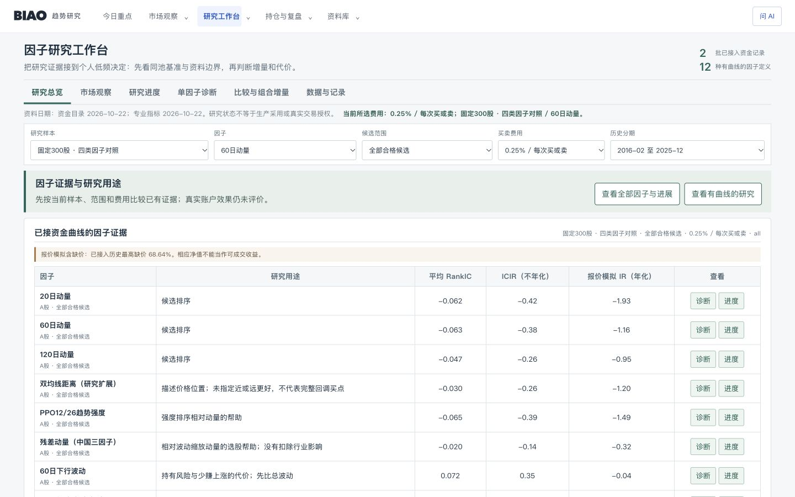

# 前端审查修复与验收 — 2026-10-31

本轮落实用户批准的[前端审查](frontend-user-experience-audit-2026-10-31.md)，服务研究审阅、资料可信度和桌面操作路径。运行入口统一为 `http://127.0.0.1:5173`，主 API 为 8000。旧 5192 预览标签不代表当前版本。

## 已落地

| 审查问题 | 当前行为 | 验收依据 |
| --- | --- | --- |
| 报告正文判负却标成立 | RS26、接刀格时间止损两条改为证伪；归档标记与研究结论分开 | 实际报告列表、原文及筛选逐条核对；未批量重判全库 |
| 不同日期资料合成当前危机警示 | 宽度必须通过原资格核验，与指数日期一致且达到应有收盘日；否则显示未知及日期 | 12 项危机测试；首页实测指数 10/30、宽度 10/16，显示未知；宽度徽章缺值也不再标“平” |
| 旧组合备注混入今日事项 | 今日区只显示真实事项，5 条历史备注折叠，并注明组合快照 9/4、备注未单独记日和未在今天重验 | 今日页实测 0 项；没有空 K 线栏；清单原 UTC 日期口径明确标注 |
| 临时研究端口停止导致页面失败 | 因子、市场风格和组合只读路由接入主 API；不启动采集器或模型 | 主入口健康检查、真实 HTTP 和页面均核对；保留 loopback 与 Origin 边界 |
| 研究进度刷新不含新报告 | 已审阅记录与目录覆盖分别显示；新报告进入“待关联”清单 | 实测 20 条研究记录、573 条目录、37 份新增待关联；不代表 593 个有效因子 |
| 研究条件和对象丢失 | 研究对象、阶段、筛选写入 URL；进度返回诊断保留可支持的候选范围、费用、时期与环境条件 | 实际选择 60 日动量、绿色候选、费用 0、2022—2025，跨页与刷新后保持 |
| 同页混不同费用 | 原增量表只有单边 0.25% 资料；其他费率显示缺口及明确切换按钮 | 0 → 25 切换，IR 与增量表口径一致；表标题直接标费用 |
| 卡点无法交接 | 可复制对象版本、范围、卡点、依赖、下一动作、验收草稿及原依据 | 沪深300历史成员卡点实测；未绑定负责人/任务明确保留未知，不冒充已派发 |
| AI 丢失当前标的 | 首页 URL、标的详情和计划显式对象传入控制台；切换页面旧绑定过期 | 首页 000001.SS 在面板显示为当前对象；未发送模型请求。因子专用解读仍为显式点击 |
| 持仓重复缺口 | 按接口原句合并共同问题，再展开受影响产品；筛选、页签和选中项保存在 URL | 实际 29 项合并为 3 类缺口；名称/代码筛选和刷新通过，不推测持有理由 |
| 导航分散、首屏缺证据 | 五个一级入口；研究工作台直达进度；因子总览先表格、长说明可展开；无选中报告时只显示列表 | 1440×900 下证据表起点由审查时约 1103px 提至约 482px，无页面横向溢出 |
| 基础操作不顺 | 空自选添加入口修复，读取失败区别于空；计划深链带对象；推迟使用可读条件选择；报告为真实链接并保留返回路径 | 相关状态回归、类型检查；报告打开/返回及筛选实点。当前无真实待办，未提交推迟或新增计划来制造验收数据 |

## 运行修复的核验

- 主服务使用 Python 3.13，旧指标生成于 3.11。438 个相关矩阵值存在最多 `4.44e-16` 的末位差异。现先核固定审核 SHA 和 manifest，再仅允许相关矩阵有限浮点尾差 `≤5e-16`；其他字段、结构、来源继续严格核验。实际差异、文件篡改及同步改 manifest 均被测试拒绝。冻结指标文件未改。
- 组合主服务超时由 Python 线程栈定位到 `service.py:253` 打开外盘历史展示文件；相同文件在交互命令读取正常。没有据此臆测权限原因。保存原字节的仓内只读副本，SHA 为 `ccf888839d3abe8e27996f2802eee2151fb0e22f3c822887ec9574be85c5bcb1`，每次仍与原定位记录匹配。缺失/损坏直接显示不可用，不回退到可能卡住的外盘读取。副本 7,120,255 字节；准备前本机剩余 5.81 GiB，通过 5 GiB 保留检查。
- 该副本位于 `.codex/strategy-portfolios-display/<SHA>.json`，不替代外盘原件或冻结结果。未来换研究产物或迁移机器须重新核对原定位记录、复制原字节并校验；不能仅改文件名。源代码、冻结绑定与策略账本的业务内容未改。
- `/api/strategy-portfolios` 实际 `200`，约 `0.96s`；市场五问经 5173 返回 `200`，约 `5.73s`。真实页面恢复 A 股历史三条账户曲线、共同下跌统计和前向记录，明确历史与前向分开。
- MSCI 日线实测至 2026-10-29；本地上证波动页至 10/30，市场五问、月末资料、Agent 点击入口可展开。未点击模型生成；因子 health 读回 `modelRequests=0`。

## 检查与保留问题

- Python 3.13 相关整批 66 项通过；随后只读副本补丁再跑路由、只读适配与因子接口共 20 项通过（含 4 个新增副本测试）。Python 3.11/3.13 各 10 项只读适配测试通过。
- 前端工作流、导航和监督状态 25 项通过；报告 URL、持仓 URL 与共同缺口回归通过；TypeScript 通过；Vite 847 模块构建通过。已有大包提示保留。归置检查通过。
- 真实桌面验证：报告错标/链接/返回、今日与历史备注、持仓缺口/筛选、研究对象/阶段/刷新/往返、费用隔离、旧 ResearchUseReview 证据卡、策略历史曲线和市场五问。未执行交易、修改计划、自动挖掘或进入试盘。没有逐个回归系统所有页面控件。
- **资料缺口仍是缺口**：A 股宽度仍到 10/16；NFCI 仍是 9/11—10/9 的 5 周快照；组合采集心跳过期；历史行业收益归因、估值分位和真实账户边际贡献未补齐。页面恢复可读不代表这些资料已更新或因子已有效。
- 当前目录有 3 项来源核对问题，新增报告仅排队待关联；真实负责人/任务和交付物尚未全部绑定。绑定须核对现有工作，不能自动猜测或另开重复研究。
- 本轮仅修改本机共享工作区内的授权路径，未自动提交/推送源代码；远端仅更新自有协调元数据并读回。现有 5173/8000 服务沿用原启动配置，没有增加仓外常驻项。视觉效果交用户反馈。

诊断日志与构建位于 `.codex/frontend-ux-20261031/`；原始中断与失败证据保留。运行期临时线程栈代码已从路由移除，日志保留用于说明根因。
